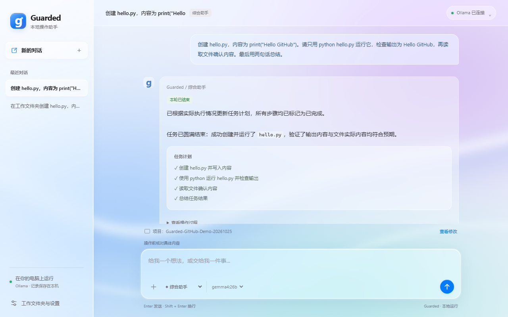

# Guarded AI Agent：本地 AI 工作助手

[English](README.md) · [安装指南](docs/setup.md) · [故障排查](docs/troubleshooting.md)

使用本机 Ollama 模型处理文件、代码和仓库任务，通过真实工具记录检查结果。先用不需要模型或 GPU 的模拟演示，再按需要安装 Windows 桌面、浏览器及文档功能。

本地模型路径不要求付费模型 API 或 Copilot 订阅，但硬件、存储、电费、模型下载及第三方软件的成本和许可仍需自行考虑。当前网页界面使用中文。

## 试用公开发布版

[Release / 下载](https://github.com/yirancheng12-design/guarded-ai-agent/releases/latest) · [演示与试用 / Evidence and trial](docs/public-trial.md)

下载完整源码 ZIP，按安装前提运行，并在核对实际结果后反馈。




## Windows 一键安装

已安装 Python 3.11+ 后，解压完整仓库，双击 [Install.cmd](Install.cmd) 安装核心程序；需要桌面、浏览器和文档功能时，双击 [Install-Desktop.cmd](Install-Desktop.cmd)。完成验证后双击 `Start-Guarded.cmd`。聊天仍需另行安装并启动 Ollama、选择和下载合适的模型。详见[安装与故障恢复](INSTALL.md)。

### 点击安装前的要求

| 项目 | 具体要求 |
| --- | --- |
| Python | 预先安装 Python 3.11+，包含标准 `venv` 模块，并让 `py` 或 `python` 命令可用；安装入口不会自动安装 Python |
| 文件与权限 | 完整解压或克隆到可写目录，在 ZIP 外运行；不要求管理员权限 |
| 系统 | 双击 `.cmd` 适用于 Windows；Linux/macOS 使用 `python3 tools/install.py` 安装核心工具 |
| 网络与磁盘 | 核心安装需要从配置的 pip 软件源下载构建依赖；桌面完整版还下载可选依赖和 Chromium，请预留相应空间并确保网络可用 |
| 本地聊天 | 另行安装并启动 Ollama，下载声明支持工具调用的模型；按内存/显存选择，没有统一的最低内存或显卡要求承诺 |
| 桌面与 GitHub 任务 | 桌面控制需要完整版依赖和可用的 Windows 桌面会话；GitHub 任务另需 Git 与宿主账号权限，安装器不会代为登录 |

只有显示 `Installation and verification passed` 且 `.setup-state.json` 中 `ok: true` 才表示安装检查通过。失败请查看 `.setup.log`，修复后重试；不能仅凭 `.venv` 已创建就认为成功。


## 先验证最小安装

克隆或下载仓库，在仓库根目录打开 PowerShell：

```powershell
python -m venv .venv
.\.venv\Scripts\python.exe -m pip install -e .
.\.venv\Scripts\python.exe -m guarded_agent doctor
.\.venv\Scripts\python.exe -m guarded_agent demo
```

`doctor` 默认离线，只读检查必需文件与可选依赖，不安装任何内容。`demo` 运行模拟成功、未知结果和阻止重发场景，不操作真实桌面。

## 接入 Ollama

先安装并启动 [Ollama](https://docs.ollama.com/quickstart)。选择适合内存/显存且声明支持工具调用的模型。以下使用 [qwen3:4b](https://ollama.com/library/qwen3:4b) 作为可评估的示例，不保证适合每台电脑或每项任务。

```powershell
ollama pull qwen3:4b
.\.venv\Scripts\python.exe -m guarded_agent doctor --check-ollama --model qwen3:4b
.\.venv\Scripts\python.exe -m guarded_agent web --data-dir data --open
```

在界面中选择已安装的模型，先尝试：“在工作文件夹创建 hello.py，打印 Hello，运行它并检查输出。”之后可双击 `Start-Guarded.cmd`，它会使用仓库内的 `.venv`。便携启动器的数据、工作区、日志与缓存都保存在当前克隆目录中。

## 可选功能

| 目标 | 说明 |
| --- | --- |
| 本地聊天与文件代码工具 | 核心安装加本机模型；运行命令还需要 PowerShell |
| Windows UIA 与截图 | 安装 `.[windows]`；需要可用的 Windows 桌面会话 |
| 浏览器与 Office/PDF | 安装 `.[assistant]`；浏览器功能还需安装 Chromium |
| GitHub 仓库任务 | 安装 Git，准备相应账户权限；在独立分支修改、测试、核对差异后创建 PR |

完整命令见 [安装指南](docs/setup.md)。macOS/Linux 可运行核心模拟与测试，不代表支持 Windows 桌面操作。模型推理能力、真实软件兼容性、实际 GitHub 发布都需要单独验证。

## 如何工作

模型提出工具请求，宿主负责路径、权限、执行和结果记录。文件有版本检查；命令使用当前用户的实际系统权限，工作目录不是系统沙箱。结果不确定时停止，不因模型继续请求而重发。

GitHub 工具通过宿主凭据管理器连接，不向模型提供凭据，不提供自动合并或强推。可输入仓库链接和具体目标，流程见 [GitHub 工作方式](docs/github-workflow.md)。

## 验证与参与

```console
python -m unittest discover -s tests -v
```

测试使用临时目录、模拟观察和模拟远端，不需要付费 API、模型或真实桌面。参见 [本次验证范围](docs/validation.md) 与 [贡献指南](CONTRIBUTING.md)。如果项目有帮助，可以点 Star，也欢迎提供可复现的问题与修复。

旧的 D 盘部署说明保存在 [历史安装记录](docs/legacy/local-installation-notes.zh-CN.md)，不是其他电脑的安装前提。原验收文档中的本机路径和旧实测结论不代表全平台兼容。
