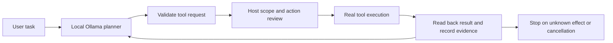

# How Guarded executes work

[Home](../README.md) · [Setup](setup.md) · [GitHub workflow](github-workflow.md)

The model proposes actions. The host controls workspace boundaries, approval decisions, actual execution, and durable records. A model's assertion of completion is not a substitute for tool evidence.

| Area | Important modules | Behavior |
| --- | --- | --- |
| Local interface and history | `web.py`, `chat_service.py` | Loopback server, local conversation storage, scoped capability token |
| Tool planning | `work_agent.py`, `ollama_agent.py` | Native tool calls or constrained action catalogs; request validation, cancellation, bounded recovery |
| Files and commands | `work_tools.py`, `workspace_tools.py` | Relative file tools, version checks/backups; reviewed shell execution under the current OS user |
| Desktop actions | `engine.py`, `journal.py`, `windows.py` | State-based execution, postcondition checks, unknown-effect protection |
| Browser work | `browser_tools.py`, `work_preview.py` | Owned browser state, observed element IDs, post-action verification |
| GitHub | `github_tools.py` | Dedicated branch, host-held credentials, test snapshot, reviewed publication, remote read-back |

The standard workspace file scope is not an operating-system sandbox for shell commands. Optional host-owned full-access policies change local access; they are not enabled by model arguments or recommended as a setup shortcut.

## What the tests establish

The shipped regression suite exercises executor behavior with simulated observations, local temporary Git repositories, injected failures, and mocked network/model responses. It checks that unknown effects do not become automatic retries, that model prose does not establish success, and that workspace/publication boundaries are enforced.

These tests make no paid API calls, do not require a local model, and send no input to desktop applications. Windows/Linux CI does not certify arbitrary real apps, model accuracy, hardware compatibility, or a live GitHub PR publication. Historical [verification notes](../VERIFICATION.md) describe a separate developer-machine session; missing referenced local paths are not shipped evidence for a fresh installation.
